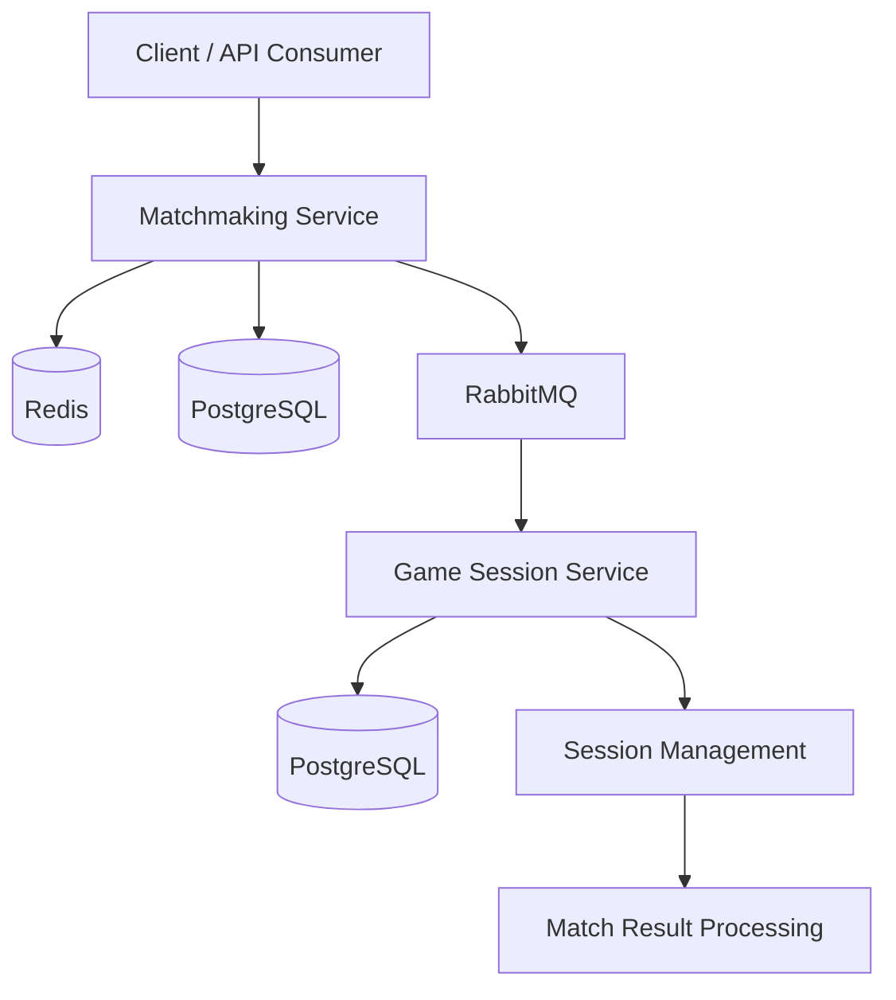

# ArenaMatch

**A Distributed Multiplayer Matchmaking Platform built with Java and Spring Boot.**

ArenaMatch is a backend engineering project focused on building a scalable matchmaking system for competitive multiplayer games. It matches players based on skill ratings, manages matchmaking queues, and coordinates game session creation through independently deployable services.

The project explores practical distributed systems concepts such as concurrency control, asynchronous messaging, fault tolerance, and service scalability.

> **Project Status:** In Development

---

## Overview

In competitive multiplayer games, matchmaking is responsible for finding suitable opponents and creating balanced matches.

ArenaMatch aims to implement this workflow through a distributed backend architecture.

Players enter a matchmaking queue, the system searches for opponents with similar skill ratings, and a match is created when suitable players are found. A separate service handles game session creation and management.

The initial game mode is **1v1 competitive matchmaking**.

### How It Works

1. A player registers and receives an initial skill rating.
2. The player joins the matchmaking queue.
3. The matchmaking engine searches for a suitable opponent.
4. A match is created when two eligible players are found.
5. A match-found event is published through RabbitMQ.
6. The Game Session Service consumes the event and creates a session.
7. Players receive their match and session details.
8. After the match, the result is processed and player ratings are updated.

---

## Architecture

ArenaMatch follows a two-service architecture.



### 1. Matchmaking Service

Responsible for finding suitable opponents and coordinating match creation.

Planned responsibilities:

- Player registration and profile management.
- Skill-based matchmaking.
- Redis-backed matchmaking queues.
- Player queue entry and cancellation.
- Concurrency-safe player assignment.
- Match creation.
- Publishing match-found events.

### 2. Game Session Service

Responsible for managing matches after opponents have been found.

Planned responsibilities:

- Consuming match-found events.
- Creating game sessions.
- Assigning matched players.
- Managing session lifecycle.
- Handling session failures and expiration.
- Processing match results.
- Updating player ratings.

---

## Technology Stack

| Category | Technology |
|---|---|
| Language | Java 23 (initial development environment) |
| Backend Framework | Spring Boot |
| Build Tool | Maven |
| Database | PostgreSQL |
| Cache and Queues | Redis |
| Message Broker | RabbitMQ |
| Testing | JUnit 5, Mockito |
| Containerization | Docker, Docker Compose |
| API Documentation | SpringDoc / OpenAPI |
| Monitoring | Spring Boot Actuator, Prometheus |
| Version Control | Git, GitHub |

---

## Core Engineering Challenges

ArenaMatch is designed to explore real-world backend engineering problems.

| Challenge | Engineering Approach |
|---|---|
| Concurrent matchmaking requests | Concurrency control and atomic operations |
| Duplicate player assignments | Atomic queue operations and locking |
| Duplicate API requests | Idempotency |
| Duplicate message delivery | Idempotent message consumers |
| Service unavailability | Retry and failure recovery |
| Growing matchmaking queues | Queue optimization and scalable processing |
| Uneven player ratings | Rating-based matchmaking with queue expansion |

These are planned engineering objectives and will be implemented and tested incrementally.

---

## Matchmaking Strategy

The initial matchmaking model uses an ELO-style player rating system.

- Starting player rating: 1000.
- Initial preferred rating difference: 100 points.
- Players are matched based on rating compatibility.
- The acceptable rating range can expand as waiting time increases.

The matchmaking strategy will be configurable so that different matching policies can be tested.

---

## Project Structure

The intended repository structure:

```text
ArenaMatch/
│
├── services/
│   ├── matchmaking-service/
│   │
│   └── game-session-service/
│
├── infrastructure/
│   ├── docker/
│   └── monitoring/
│
├── docs/
│   ├── architecture/
│   ├── api/
│   └── decisions/
│
├── docker-compose.yml
├── README.md
└── .gitignore
```

---

## Development Roadmap

- [ ] Set up Java and Spring Boot development environment.
- [ ] Initialize Matchmaking Service.
- [ ] Implement player registration and management.
- [ ] Implement matchmaking REST APIs.
- [ ] Integrate Redis for matchmaking queues.
- [ ] Implement skill-based matchmaking.
- [ ] Handle concurrent matchmaking requests.
- [ ] Initialize Game Session Service.
- [ ] Integrate RabbitMQ for inter-service communication.
- [ ] Implement game session lifecycle management.
- [ ] Implement match result processing and rating updates.
- [ ] Add failure recovery and idempotency.
- [ ] Write unit and integration tests.
- [ ] Containerize services using Docker Compose.
- [ ] Add monitoring and observability.
- [ ] Perform load and performance testing.

---

## Running Locally

Local development instructions will be added as the services and infrastructure are implemented.

The planned local environment will use Docker Compose for PostgreSQL, Redis, and RabbitMQ.

---

## Project Goals

The primary goal of ArenaMatch is to gain practical experience building distributed backend systems.

Key learning objectives:

- Design and develop Java-based microservices.
- Understand concurrency and thread safety.
- Work with Redis for low-latency queue operations.
- Implement asynchronous communication using RabbitMQ.
- Design reliable service-to-service workflows.
- Handle failures, retries, and duplicate processing.
- Test and measure backend performance.

---

## License

To be decided.
